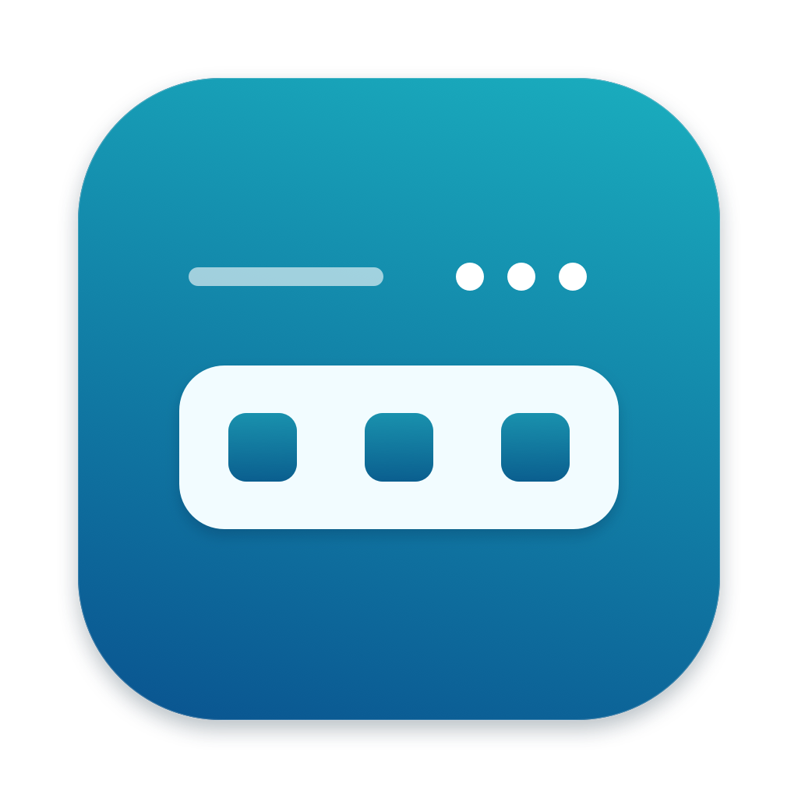

  

<h1 align="center">SideTray</h1>

  <strong>A little more room in your Mac’s menu bar.</strong> 
  Keep your everyday apps visible. Tuck everything else into a tray, one click away.

  <a href="https://github.com/samihsoylu/side-tray/releases"><strong>Download the beta</strong></a> ·
  <a href="#get-started">Get started</a> ·
  <a href="#updates">Updates</a> ·
  <a href="https://github.com/samihsoylu/side-tray/issues">Report an issue</a>

macOS 27 · Apple Silicon and Intel · Built with Swift and AppKit

## Your menu bar, with room to breathe

SideTray puts less-used menu bar apps behind a three-dot button. Click it to open a compact row directly below the menu bar. The tray expands leftward, so your icons remain reachable even on a Mac with a camera notch.

- **Keep the essentials close.** Choose which apps stay visible, to the right of the three-dot button.
- **Open the menus you already know.** Click a tray icon to open that app’s real menu. Its menu bar icon stays available while the menu is open.
- **Stay out of the way.** Click elsewhere or press Escape to close the tray.
- **Make it yours.** Set a keyboard shortcut and choose whether SideTray starts when you log in.

## Get started

1. [Download the latest beta](https://github.com/samihsoylu/side-tray/releases), unzip it, and move **SideTray.app** to **Applications**.
2. Open SideTray. Setup guides you to the two required permissions in **System Settings → Privacy & Security**.
3. Choose the apps you want to keep in the menu bar, then click **Start SideTray**.

In **Settings → Apps**, checked apps stay visible; unchecked apps appear in the tray. New apps go into the tray by default. Right-click the three dots to open Settings, check for updates, or quit.

> **Beta installation:** SideTray is not yet Apple Developer ID signed or notarized. macOS may block the first launch. If you trust this download, use the app-specific **Open Anyway** option in Privacy & Security when offered. Do not turn off Gatekeeper. Earlier SideTray versions need a manual update to 0.2.0 before in-app updates are available.

## Why the permissions?

**Device Control and Data Access** lets SideTray find and open other apps’ menu bar items. **Full Disk Access** lets it read and change the protected macOS settings that control icon visibility. This is a broad permission; SideTray uses it for menu bar settings and their recovery records.

Screen Recording is not required. App choices stay on your Mac. Update checks contact GitHub; SideTray does not send usage analytics or your app list.

## Updates

SideTray checks daily and downloads available updates. When one is ready, open **Settings → General** and click **Install and Relaunch**. You can turn automatic checks off or check manually. Quitting without choosing Install leaves your current version in place.

Downloads and the update feed are verified before installation. Apple signing and notarization are still pending, so macOS may ask you to renew permissions after an update. [Permission help](docs/HELP.md)

## Still in beta

SideTray currently supports **macOS 27**. It uses macOS’s internal menu bar settings, which can change in future system updates. Avoid running it alongside another menu bar manager.

The download includes Apple Silicon and Intel binaries. Live development testing has been on Apple Silicon; testing on other Macs, multiple displays, and everyday sleep/login cycles is ongoing. [Second-Mac test guide](SECOND-MAC-TEST.md)

## For developers

[Build and test](docs/DEVELOPMENT.md) · [Prepare a release](docs/RELEASING.md)

Licensed under the [GNU General Public License v3.0](LICENSE). Sparkle’s license is included in [ThirdParty](ThirdParty/Sparkle-LICENSE.txt).

## Author

Samih Soylu

[mail@samihsoylu.nl](mailto:mail@samihsoylu.nl)
